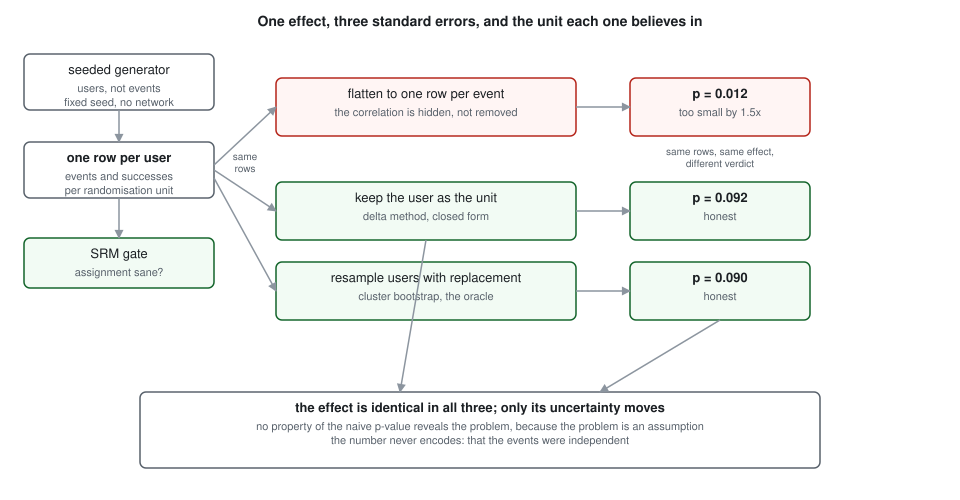
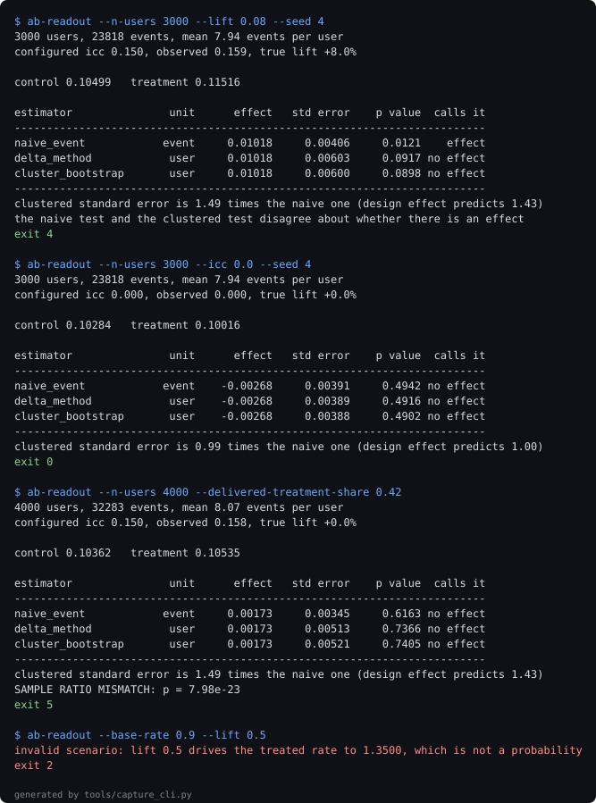

# ratio-metric-ab-readout

**Measures how badly a per-event significance test misreads a per-user experiment, and prices what fixing it costs in power.**

[](https://github.com/jayanthkodamachili/ratio-metric-ab-readout/actions/workflows/ci.yml)


## What a p-value cannot tell you

A two-sample test on a per-event table performs arithmetic that is correct for independent observations. When users were randomised, one user's events are not independent, and the arithmetic is identical either way. The test returns a well formed p-value, of plausible magnitude, computed from a standard error that is too small.

Four questions this answers that the p-value structurally cannot:

1. Whether the number was computed at the unit the experiment actually randomised on.
2. How much of the apparent precision came from counting one user's eight correlated events as eight independent facts.
3. Whether this mistake matters for your data, given that it is harmless at one event per user and severe at thirty-two.
4. What the honest version costs: how much power the experiment really had, as opposed to how much it appeared to have.

The fourth is the one teams are least prepared for. Fixing the variance does not find more effects. It finds fewer, and the ones it loses were never there.

## The numbers

Over **2000 A/A replicates** with no true effect anywhere, 4000 users, 8 events per user, at a nominal alpha of 0.05:

- The naive per-event test **claims an effect in 0.191** of them. That is **3.8 times** the advertised rate. The **delta method sits at 0.053** and the **bootstrap at 0.057**.
- The clustered standard error is **1.475 times larger** than the naive one. The design effect **predicts 1.432** from the cluster size and correlation alone, so simulation and textbook agree without being told to.
- **The uncomfortable one:** the correction costs real power. At **16000 users** against a true 6 percent lift, the naive test **appears to reach 0.858** power while the **real power is 0.664**. The corrected test never reaches 80 percent anywhere in the sweep, which means an experiment sized on the naive variance was underpowered for the effect it was sized to find.

103 tests, 100 percent line coverage, and every figure above is re-measured by CI from the experiments rather than typed into this file. `tools/check_numbers.py` fails the build if any of them drifts.

## Quickstart

Requires Python `3.11` or newer. No credentials, no network at runtime.

```bash
pip install -e ".[dev]"

# the case the whole repository is about: same rows, two verdicts
ab-readout --n-users 3000 --lift 0.08 --seed 4

# everything: lint, suite, re-measure all four experiments, check the prose
make verify
```

`make verify` re-runs the experiments from scratch and takes several minutes. `make receipts-fast` reuses the committed experiment JSON while iterating.

## The claim, one section at a time

### The same rows, two verdicts

```
estimator             unit      effect   std error    p value   calls it
naive_event          event     0.01018     0.00406     0.0121     effect
delta_method          user     0.01018     0.00603     0.0917  no effect
cluster_bootstrap     user     0.01018     0.00600     0.0898  no effect
```

Read the effect column. It is the same number three times, because the effect is a fact about the data and is not in dispute. Only the standard error moved, and it moved enough to flip the decision. A team running this experiment ships the feature or does not, depending on which row they happened to compute.

### The error is not constant, it scales with cluster size

| events per user | naive FPR | delta FPR | measured SE ratio | theory predicts |
| --- | --- | --- | --- | --- |
| 1 | 0.047 | 0.047 | 1.000 | 1.000 |
| 2 | 0.080 | 0.045 | 1.107 | 1.072 |
| 4 | 0.085 | 0.040 | 1.249 | 1.204 |
| 8 | 0.195 | 0.033 | 1.477 | 1.432 |
| 16 | 0.307 | 0.050 | 1.842 | 1.803 |
| 32 | 0.388 | 0.045 | 2.406 | 2.377 |

The naive test is correct at **0.047 at one event** per user, because with one event per user there is no cluster to get wrong. It **rises to 0.388** at thirty-two. The delta method holds near nominal across the whole range.

The right-hand columns are two independent routes to the same quantity: a simulation that knows nothing about the design effect formula, and the formula, which knows nothing about the simulation. Across either sweep they sit within **no more than 0.085** of each other.

### The condition, not just the symptom

| intra-class correlation | naive FPR | measured SE ratio | theory predicts |
| --- | --- | --- | --- |
| 0.00 | 0.035 | 1.000 | 1.000 |
| 0.02 | 0.070 | 1.077 | 1.068 |
| 0.05 | 0.102 | 1.180 | 1.162 |
| 0.10 | 0.130 | 1.336 | 1.304 |
| 0.20 | 0.232 | 1.603 | 1.549 |
| 0.40 | 0.317 | 2.034 | 1.949 |

Cluster size alone breaks nothing. What breaks the test is cluster size combined with within-user similarity. At zero correlation the naive rate **falls to 0.035** with a standard error **ratio of exactly 1.000**, and it **reaches 0.317 at a correlation** of 0.40.

This is the result that makes the repository an explanation rather than a demonstration. The naive test is not wrong in general; it is wrong under a condition, and the condition can be switched off.

### What it costs against what it buys

| users | power the naive test appears to have | power it really has |
| --- | --- | --- |
| 1000 | 0.244 | 0.072 |
| 2000 | 0.336 | 0.140 |
| 4000 | 0.426 | 0.208 |
| 8000 | 0.608 | 0.380 |
| 16000 | 0.858 | 0.664 |

What it buys: a false positive rate that means what it says. What it costs: **0.194 points of power** at the largest sample here, and a sample size plan that was wrong from the start.

The honest reading for a practitioner is not "use the delta method and carry on". It is that an experiment designed around a naive variance was never powered for the effect it was designed to detect, and the design has to be redone rather than the analysis patched.

## The bugs the measurement found

**The SRM gate could not fire.** A test asserting that a sample ratio mismatch halts the readout failed, and the test was right. The generator took its split from `treatment_share`, and the gate checked the realised split against that same `treatment_share`, so the two numbers agreed by construction and the gate was unreachable decoration. `delivered_treatment_share` now separates what the experiment declared from what the assignment mechanism actually shipped. A gate that cannot fire is worse than no gate, because it looks like coverage.

**A power sweep wrote nan and reported success.** An early version ran lifts up to 15 at a base rate of 0.1. The treated rate went above one, the beta shape parameter went negative, numpy returned nan without raising, and the p-value came back nan. The sweep completed and wrote nan into its JSON. The config now refuses a lift that drives the treated rate outside (0, 1), at the point the scenario is described rather than several layers down.

**One branch is genuinely unreachable and says so.** The intra-class correlation estimator has a division guard that no input reaches, because the preceding guard already catches every case that could zero both mean squares. It is marked as uncovered with the reasoning written out, rather than deleted or papered over with a test that cannot exist.

## Architecture



Generated by `tools/render_diagram.py` and committed. CI regenerates it and fails if the committed copy has drifted.

## Evidence



A replay of real stdout, captured by `tools/capture_cli.py` at generation time: the disagreement case (exit 4), the zero-correlation case where the naive test is correct (exit 0), an injected assignment fault caught by the gate (exit 5), and an impossible scenario refused (exit 2). Every command and the exit code it actually returned are in [docs/evidence-manifest.json](docs/evidence-manifest.json).

## The fixture

There is no committed dataset. Measuring a false positive rate requires data where the absence of an effect is a fact rather than an estimate, which no real experiment log can provide. The generator is a beta-binomial: each user carries a propensity, their events are draws at that propensity, and one parameter controls how strongly a user's events resemble each other.

The awkward cases it is set up to produce, rather than the easy ones:

- One event per user, where the design effect is exactly one and every estimator must agree. If they ever disagree there, something is broken.
- Correlation of exactly zero, where the naive test is correct and the repository's own premise does not apply.
- Correlation of 0.40 with thirty-two events per user, where the naive standard error is wrong by more than a factor of two.
- A **declared 50 percent** split that the mechanism does not deliver, so the SRM gate has something real to catch.

## What this cannot measure

Its own section, because these are the limits a reviewer should know before trusting anything above.

- **Synthetic data only.** The mechanism is structural and transfers to any clustered experiment. The magnitudes are properties of this generator. No figure here should be quoted as a fact about a real product.
- **One source of clustering.** Users here contribute events and nothing else. Real experiments have sessions inside users, devices shared between users, and network effects between them, each adding a route to the same failure that this does not model.
- **Fixed horizon only.** Every test here is computed once, at the end. Looking at an experiment while it runs inflates the false positive rate through a completely different mechanism, which this repository neither measures nor corrects. That is the Pivot below.
- **The SRM gate tests counts and nothing else.** It compares the number of users per arm against the declared split. An assignment that splits users evenly while correlating with the metric, a redirect that silently drops a slow-loading cohort, passes it untouched.
- **A measured rate is not an exact rate.** Every false positive rate here is a sample proportion with a confidence interval, published in the experiment JSON. The headline 0.191 is the centre of an interval, not a constant.
- **Declared, not observed:** that this generator's distribution resembles any production experiment. It was chosen to be awkward, not to be representative.

See [ADR-005](docs/adr/ADR-005-what-this-cannot-measure.md).

## Layout, exit codes and reproduction

```
src/ratio_readout/
  config.py       frozen scenario, rejects impossible lifts and splits
  generate.py     beta-binomial generator, user level rows only
  estimators.py   the three standard errors, side by side
  srm.py          the assignment gate, and what it cannot catch
  readout.py      orchestration and the disagreement flag
  cli.py          exit codes that carry the verdict
experiments/      four experiments writing JSON to docs/experiments
tools/            metric collection, number checker, diagram, capture
docs/adr/         five decision records
```

| exit code | meaning |
| --- | --- |
| 0 | ran fine, no significant effect |
| 1 | ran fine, significant effect under the clustered estimator |
| 2 | the scenario was rejected before any computation |
| 3 | the readout itself failed |
| 4 | the estimators disagree about whether there is an effect |
| 5 | sample ratio mismatch, assignment is broken |

Codes 0, 1, 4 and 5 all mean the tool worked. Only 2 and 3 mean it did not. Code 4 exists because a disagreement is a finding about the measurement process rather than about the experiment, and a pipeline should route it to a human rather than treat it as a result.

| target | what it does |
| --- | --- |
| `make lint` | ruff |
| `make test` | suite with a coverage floor |
| `make experiments` | re-runs all four, rewriting their JSON |
| `make figures` | regenerates the diagram and the captured session |
| `make receipts` | re-measures every figure, then checks the prose |
| `make verify` | lint, test, receipts |

The number checker matches anchor phrases rather than bare digits, in both directions. Forward, every metric must appear in a checked document using its anchor wording. Backward, every decimal in the prose must correspond to a metric, so a number nothing re-measures cannot take up residence. Change any figure in this README, run `python tools/check_numbers.py`, and watch it fail; change it back and watch it pass.

## Stack

| technology | role | why here |
| --- | --- | --- |
| numpy | generation, aggregation, the bootstrap | the delta method is twelve lines of algebra and belongs in the open |
| scipy | normal and chi-square tails | two distribution functions, nothing more |
| pytest with a coverage floor | the suite | the theory check is a test, so a broken claim fails the build |
| ruff | lint and import order | one tool, one CI step |
| plain SVG, hand written | the diagram | eleven boxes that will not grow, against a Mermaid fence GitHub sometimes declines to render |
| no statsmodels | deliberately absent | it would make the variance a one-line import and the repository unreadable as an explanation |

## Decision records

1. [ADR-001: the delta method as the default, the bootstrap as the oracle](docs/adr/ADR-001-delta-method-default.md)
2. [ADR-002: validate by simulation rather than by derivation](docs/adr/ADR-002-simulation-over-derivation.md)
3. [ADR-003: the simple bootstrap loop, after measuring the vectorised one](docs/adr/ADR-003-bootstrap-loop.md)
4. [ADR-004: a committed SVG rather than a Mermaid fence](docs/adr/ADR-004-committed-svg.md)
5. [ADR-005: what this repository deliberately cannot measure](docs/adr/ADR-005-what-this-cannot-measure.md)

## The Pivot

Sequential testing is deliberately out of scope. Everything here assumes the test is computed once, at a fixed horizon.

The trigger for adding it is specific: the moment anyone wants to look at a running experiment and decide whether to stop. At that point the fixed-horizon p-value is the wrong instrument no matter how its variance was computed, and the answer is an always-valid method such as mSPRT rather than a better standard error.

Future work, in order:

- Variance reduction with CUPED, which is the other half of the power conversation this repository only opens.
- Nested clustering, where sessions sit inside users and the design effect compounds.
- A real experiment log, to see which of these magnitudes survive contact with a real user base.
- Always-valid inference, as the Pivot describes.
- First metric to watch on any of these: whether the measured standard error ratio still tracks the predicted design effect, because every other result here rests on that agreement.

